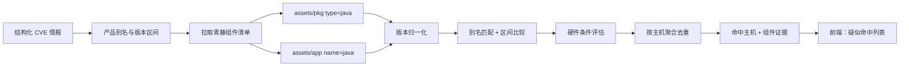

# CVE 组件版本匹配设计（青藤万相）

> 状态：设计稿，待评审
> 日期：2026-11-19
> 关联功能：资产发现 → 青藤数据表 → CVE 影响面

## 1. 背景与目标

现有「CVE 影响面」通过青藤漏洞检测（`vul/poc`，字段 `cves`）与补丁检测（`vul/patch`，字段 `ref`）反查主机，属于**青藤规则库确认命中**。

但实际 CVE 情报中大量是「应用/运行时组件漏洞」，例如：

- CVE-2026-114938：OpenJDK Base64 解码器远程代码执行；
- 影响范围是 JDK 8/17/21/25/27 的特定版本区间；
- 新 CVE 往往还没进入青藤漏洞库/补丁库，现有查询会返回 `covered=false`。

本设计新增一条**组件版本匹配**通道：用结构化 CVE 情报去匹配青藤主机上的组件清单（安装包/软件应用），输出疑似命中主机及组件证据。

目标：

1. 支持录入 CVE 影响产品、版本区间、精确版本、硬件前置条件；
2. 从青藤拉取组件清单并按产品别名 + 版本区间匹配；
3. 按主机聚合展示命中组件、当前版本、命中区间、证据等级；
4. 与现有「青藤确认命中」结果并列展示，明确区分证据强度。

非目标：

- 不替代青藤漏洞库/补丁库的确认结论；
- 不做补丁安装、文件隔离等处置动作；
- 首期不做预警通知 docx 的自动解析（后续可扩展）。

## 2. 适用范围

首期覆盖组件类 CVE：

| 类型 | 青藤数据源 | 说明 |
|---|---|---|
| Linux Java/OpenJDK | `assets/pkg/linux`（`type=java`）、`assets/app/linux` | 包管理器安装的 JDK 用 pkg，解压安装的 JDK 用 app |
| Windows Java/OpenJDK | `assets/app/win`、`assets/pkg/win` | Windows 以软件应用为主 |
| 中间件/数据库/Web 框架 | `assets/app`、`assets/webapp`、`assets/dbfinfo`、`assets/webframe` | 复用同一套匹配模型，按产品别名扩展 |
| 操作系统包 | `assets/pkg` | 按包名 + 版本匹配 |

首期不覆盖：

- 容器内组件（青藤标准数据无容器资产表）；
- 内核模块/驱动类 CVE（走青藤漏洞检测更合适）；
- 需要运行时动态验证的 CVE（需要 POC 作业）。

## 3. 总体流程



流程说明：

1. 情报录入后校验 CVE 格式、版本区间合法性；
2. 组件清单一台设备只拉一次，进程内缓存 10 分钟；
3. 版本归一化后与区间比较，产品别名做关键字匹配；
4. 硬件条件只做“架构已知/未知”判断，指令集标记待确认；
5. 同一主机同一组件多版本命中时保留最高证据等级；
6. 结果与现有青藤确认命中分开返回、分开展示。

## 4. 数据模型

### 4.1 CVE 情报 Profile

```json
{
  "cve": "CVE-2026-114938",
  "title": "OpenJDK Base64 解码器远程代码执行漏洞",
  "severity": "高危",
  "type": "远程代码执行",
  "published": "2026-11-17",
  "affected": [
    {
      "product": "OpenJDK",
      "aliases": [
        "openjdk", "jdk", "jre", "java",
        "temurin", "corretto", "zulu", "liberica", "sapmachine", "graalvm"
      ],
      "exclude_keywords": ["openjdk-doc", "openjdk-source"],
      "ranges": [
        { "min": "17.0.6", "max": "17.0.21.0.3", "include_min": true, "include_max": true },
        { "min": "21", "max": "21.0.13.0.3", "include_min": true, "include_max": true },
        { "min": "25", "max": "25.0.5.0.3", "include_min": true, "include_max": true },
        { "min": "27", "max": "27.0.1.0.3", "include_min": true, "include_max": true }
      ],
      "exact": ["8u511b33-perf"]
    }
  ],
  "constraints": {
    "arch": ["x86_64"],
    "cpu_features": ["AVX-512F", "AVX-512BW", "AVX-512VBMI", "BMI2"]
  },
  "remediation": {
    "patch": "应用 2026-11-17 OpenJDK 安全补丁",
    "workaround": "-XX:-UseBase64Intrinsics"
  }
}
```

字段说明：

| 字段 | 必填 | 说明 |
|---|---|---|
| `cve` | 是 | 归一化为大写，格式 `CVE-YYYY-N` |
| `severity` | 否 | 展示用 |
| `affected[].product` | 是 | 产品族名称，用于展示与分组 |
| `affected[].aliases` | 是 | 命中组件名/包名的关键字，大小写不敏感 |
| `affected[].exclude_keywords` | 否 | 排除项，避免 `doc/source` 等误报 |
| `affected[].ranges` | 否 | 版本区间，闭区间默认包含端点 |
| `affected[].exact` | 否 | 精确版本，优先级高于区间 |
| `constraints.arch` | 否 | 主机架构条件 |
| `constraints.cpu_features` | 否 | 指令集条件，青藤无字段时标记未知 |
| `remediation` | 否 | 修复建议与缓解措施 |

### 4.2 匹配命中

```json
{
  "source": "pkg",
  "component": "openjdk-17-jre-headless",
  "version": "17.0.9+9-1~deb12u1",
  "normalized_version": "17.0.9",
  "component_type": "java包",
  "install_path": "",
  "matched_rule": { "min": "17.0.6", "max": "17.0.21.0.3" },
  "match_type": "range",
  "confidence": "中",
  "evidence": "包版本 17.0.9 落在受影响区间 17.0.6 - 17.0.21.0.3"
}
```

证据等级：

| 等级 | 条件 |
|---|---|
| 高 | 应用版本精确命中；或包版本无发行版修订号且落在区间 |
| 中 | 包版本带发行版修订号，剥离后落在区间；或产品名仅关键字匹配 |
| 低 | 版本信息不完整、无法可靠比较，仅作提醒 |

## 5. 匹配规则

### 5.1 组件清单拉取

| 接口 | 参数 | 用途 |
|---|---|---|
| `GET /external/api/assets/pkg/{linux\|win}/list` | `type=java`、`page`、`size` | Java 安装包 |
| `GET /external/api/assets/app/{linux\|win}/list` | `name=java`、`page`、`size` | Java 应用/运行时 |
| `GET /external/api/assets/webapp/{os}/list` | `name` | 中间件扩展 |
| `GET /external/api/assets/dbinfo/{os}/list` | `name` | 数据库扩展 |

拉取策略：

- 按资源类型全量分页拉取，单类上限 20 万条，超出记录告警；
- 同一设备索引缓存 10 分钟，支持强制刷新；
- 详情类接口不逐主机调用，避免 N×M 放大。

### 5.2 产品别名匹配

1. 组件名统一转小写；
2. 使用词边界匹配，避免 `jdk` 命中 `jdkzip`；
3. `exclude_keywords` 命中时直接排除；
4. 同时支持包名与应用名两套字段。

示例：

| 组件名 | 是否命中 | 原因 |
|---|---|---|
| `openjdk-17-jre-headless` | 是 | 命中 `openjdk` |
| `temurin-17-jdk` | 是 | 命中 `temurin` |
| `openjdk-17-source` | 否 | 命中排除词 `source` |
| `jdkzip-utils` | 否 | 词边界不匹配 |

### 5.3 版本归一化与比较

归一化步骤：

1. 去首尾空格，转小写；
2. 去掉 epoch，如 `1:17.0.9-...`；
3. 去掉发行版修订号：`-1~deb12u1`、`-0ubuntu1`、`.el8`；
4. 去掉构建号后缀：`+9`、`b33`；
5. 保留上游版本主体：`17.0.9`；
6. 特殊格式单独处理：`8u511b33-perf` 解析为 `(8, 511, 33, perf)`。

比较规则：

- 按 `.`、`-`、`_` 分段；
- 纯数字段按数值比较，缺失段按 0；
- 字母段按字典序，预发布标识低于正式版；
- 区间判断：`min <= version <= max`，端点默认包含；
- 精确版本优先于区间匹配。

边界用例：

| 当前版本 | 区间/精确 | 结果 |
|---|---|---|
| `17.0.6` | `17.0.6 - 17.0.21.0.3` | 命中（下边界） |
| `17.0.21.0.3` | `17.0.6 - 17.0.21.0.3` | 命中（上边界） |
| `17.0.21.0.4` | 同上 | 不命中 |
| `17.0.9+9-1~deb12u1` | 同上 | 命中，证据等级中 |
| `8u511b33-perf` | 精确 | 命中，证据等级高 |
| `8u511b33` | 精确 | 不命中 |

### 5.4 硬件条件评估

| 条件 | 青藤字段 | 处理 |
|---|---|---|
| 架构 `x86_64` | `assets/host.cpu.cpuArch` | 一致则 `matched`，缺失则 `unknown` |
| CPU 指令集 AVX-512 VBMI | 无 | 统一标记 `unknown`，前端提示“需主机侧确认” |
| CPU 型号 | `cpu.brand`、`cpu.description` | 仅展示，不参与自动判定 |

### 5.5 去重与聚合

- 去重键：`agent_id + 归一化组件名 + 归一化版本`；
- 同一主机同一组件多来源（pkg 与 app）命中时，保留证据等级高的记录并合并来源；
- 同一主机多版本 JDK 全部展示，不合并版本；
- 主机键使用 `agentId`，IP 仅展示。

## 6. 接口设计

### 6.1 组件版本匹配

```http
POST /api/v1/govcloud/qingteng/cve-match
```

请求：

```json
{
  "device_id": 1,
  "refresh": false,
  "profile": {
    "cve": "CVE-2026-114938",
    "severity": "高危",
    "affected": [
      {
        "product": "OpenJDK",
        "aliases": ["openjdk", "jdk", "jre", "temurin", "corretto", "zulu"],
        "exclude_keywords": ["source", "doc"],
        "ranges": [{ "min": "17.0.6", "max": "17.0.21.0.3" }],
        "exact": ["8u511b33-perf"]
      }
    ],
    "constraints": { "arch": ["x86_64"], "cpu_features": ["AVX-512VBMI"] },
    "remediation": { "patch": "应用 2026-11-17 补丁" }
  }
}
```

响应：

```json
{
  "cve": "CVE-2026-114938",
  "built_at": "2026-11-19 15:00:00",
  "summary": {
    "host_count": 3,
    "component_hit_count": 5,
    "confirmed_host_count": 0,
    "suspected_host_count": 3
  },
  "hosts": [
    {
      "agent_id": "a1b2c3",
      "host_ip": "10.0.0.8",
      "host_name": "app-01",
      "biz_group": "核心业务",
      "owner": "张三",
      "location": "A机房",
      "os_type": "linux",
      "cpu_arch": "x86_64",
      "arch_matched": true,
      "cpu_feature_status": "unknown",
      "hits": [
        {
          "source": "pkg",
          "component": "openjdk-17-jre-headless",
          "version": "17.0.9+9-1~deb12u1",
          "normalized_version": "17.0.9",
          "component_type": "java包",
          "matched_rule": { "min": "17.0.6", "max": "17.0.21.0.3" },
          "match_type": "range",
          "confidence": "中",
          "evidence": "包版本 17.0.9 落在受影响区间 17.0.6 - 17.0.21.0.3",
          "remediation": "应用 2026-11-17 补丁"
        }
      ]
    }
  ],
  "warnings": []
}
```

错误码：

| 状态码 | 场景 |
|---|---|
| 400 | CVE 格式错误、版本区间非法、产品别名为空 |
| 404 | 青藤设备不存在或未启用 |
| 502 | 青藤接口失败、超时、响应格式异常 |

权限：`asset_discovery:view`（只读）。
限流：同一设备索引构建串行，查询走缓存。
超时：前端 180 秒；后端单次青藤请求使用设备超时配置。

### 6.2 与现有接口的关系

| 接口 | 数据来源 | 证据 |
|---|---|---|
| `GET /qingteng/cve-hosts` | 青藤漏洞/补丁检测结果 | 确认命中 |
| `POST /qingteng/cve-match` | 青藤组件清单 + 版本区间 | 疑似命中 |

前端可并行调用两个接口，分别展示「青藤确认」与「版本疑似」。

## 7. 前端交互设计

### 7.1 入口

现有「CVE 影响面」弹窗改为两个标签页：

- `青藤检测命中`：保留现有查询；
- `组件版本匹配`：新增结构化情报表单。

### 7.2 表单

| 控件 | 说明 |
|---|---|
| CVE 编号 | 必填，自动大写 |
| 产品名称 | 展示用，如 OpenJDK |
| 产品别名 | 标签输入，支持逗号分隔 |
| 版本区间 | 动态行，min/max，可增删 |
| 精确版本 | 逗号分隔 |
| 架构条件 | 多选，如 x86_64 |
| CPU 指令集 | 多选，标记“青藤无法自动确认” |
| 修复建议 | 多行文本 |

辅助功能：

- 「粘贴 JSON」：直接导入 profile；
- 「载入示例」：填入 Java4Shell 示例，便于验证；
- 「刷新索引」：忽略 10 分钟缓存。

### 7.3 结果展示

- 顶部汇总：疑似主机数、组件命中数、确认命中数；
- 主机列表：IP、主机名、业务组、负责人、机房、CPU 架构、命中数；
- 展开命中卡片：
  - 组件名、当前版本、归一化版本；
  - 命中区间或精确版本；
  - 证据等级（高/中/低）与来源（pkg/app）；
  - 安装路径、组件类型；
  - 修复建议；
  - 硬件条件：架构匹配 / 指令集待确认；
- 风险提示条：
  - “组件版本匹配为推断结果，不等于漏洞可利用”；
  - “指令集条件青藤未采集，需主机侧确认”；
  - “容器内组件不在主机清单中”。

## 8. 性能与缓存

| 项 | 设计 |
|---|---|
| 组件索引缓存 | 10 分钟，按设备维度 |
| 分页大小 | 500 |
| 单类记录上限 | 20 万 |
| 详情并发 | 6（仅现有漏洞/补丁接口需要） |
| 首查耗时 | 组件清单通常比漏洞详情快，预计数秒到数十秒 |
| 刷新策略 | 手动刷新 + TTL 过期 |

## 9. 安全与合规

- 只读接口，不产生设备配置变更；
- 复用 `asset_discovery:view` 权限；
- 出站地址经 `validate_outbound_url` 校验；
- 不记录设备密码、Token、签名密钥；
- 查询日志记录设备、CVE、耗时、命中数量，便于审计；
- 返回组件路径时按现有资产接口口径展示，不额外扩大敏感信息范围。

## 10. 边界与风险

1. **版本推断不等于确认命中**：发行版回填补丁会导致包版本高于上游但已修复，需人工复核。
2. **容器内 JDK 不可见**：青藤标准数据无容器资产表。
3. **多版本共存**：同一主机可能存在多个 JDK，需全部展示。
4. **包名差异大**：不同发行版包名不同，依赖别名与排除词维护。
5. **指令集无法确认**：AVX-512 VBMI 等条件青藤未采集。
6. **组件清单时效**：依赖青藤采集周期，新装组件可能尚未入库。
7. **Windows 组件信息弱于 Linux**：以软件应用为主，版本可能不完整。

## 11. 测试计划

单元测试：

- 版本比较：边界、发行版修订号、`8u511b33-perf`、预发布版本；
- 别名匹配：词边界、排除词、大小写；
- 区间校验：非法 min/max、空区间、精确版本优先；
- 聚合去重：同一组件多来源、同一主机多版本。

集成测试：

- Mock 青藤 `pkg`/`app` 响应，验证匹配结果与证据等级；
- Mock 分页与接口忽略分页场景，验证不会死循环；
- Mock 接口失败，验证告警与部分结果返回。

验收用例：

- 使用 CVE-2026-114938 的 profile，构造 3 台主机：
  - `openjdk-17-jre 17.0.9` → 疑似命中；
  - `openjdk-21-jre 21.0.14.0.3` → 不命中；
  - `temurin-8u511b33-perf` → 精确命中；
- 验证前端展示、证据等级、硬件条件提示。

## 12. 落地任务拆分

| 阶段 | 任务 |
|---|---|
| 后端 | 新增 `app/core/qingteng_component_match.py`：组件拉取、版本比较、别名匹配、聚合 |
| 后端 | 新增 `POST /govcloud/qingteng/cve-match`，复用设备校验与主机信息补齐 |
| 后端 | 单元测试：版本比较、匹配、接口 mock |
| 前端 | 「CVE 影响面」弹窗新增「组件版本匹配」标签页与表单 |
| 前端 | 结果列表、命中卡片、证据等级与硬件提示 |
| 文档 | 更新接口文档与使用说明 |

## 13. 后续扩展

- 预警通知 docx/文本自动解析为 profile（模型抽取 + 人工确认）；
- 对接 Kafka 标准数据 `asset_pkg`、`asset_app`，替代 API 全量拉取；
- 命中结果落库，形成 CVE 影响面趋势与处置跟踪；
- 与工单联动：疑似命中主机一键生成排查/修复工单。
