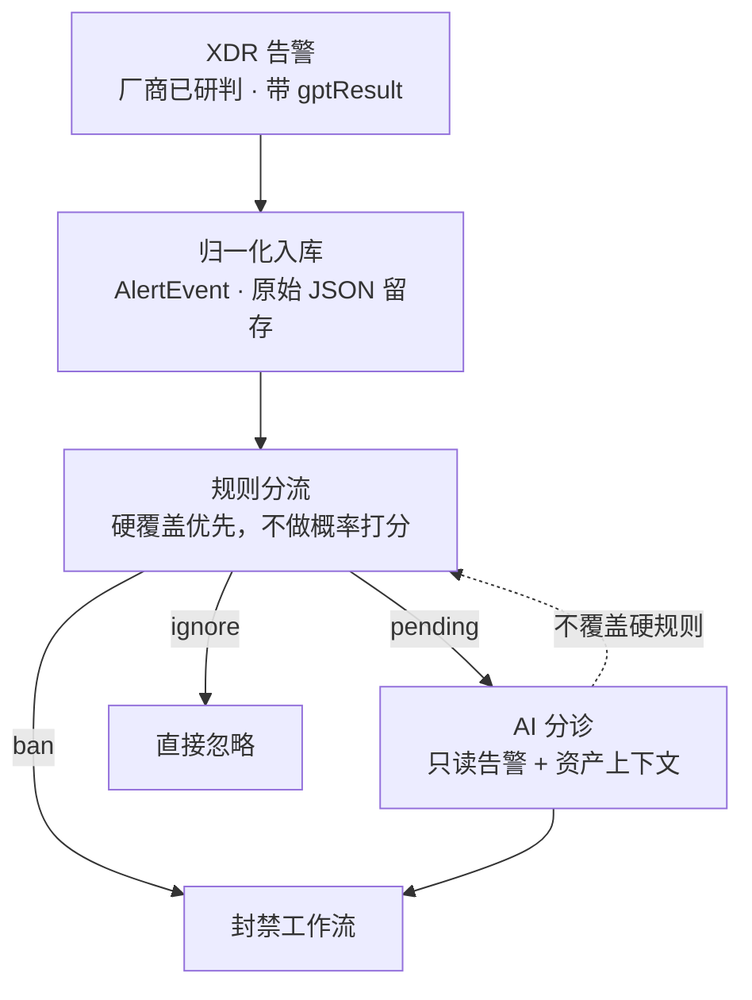

# 深信服 XDR 接入改造方案（初版）

| 项 | 内容 |
|---|---|
| 文档状态 | 初版，可按本文实施 |
| 适用范围 | 本仓库 SOAR 平台的深信服 XDR 接入 |
| 实施顺序 | 一期闭环 → 二期多平台 → 三期整理与取证 |
| 代码范围 | 仅 `soar-src`。不修改 AiSOC、Wazuh 仓库，不引入这两个产品的进程或数据模型 |

## 1. 背景

SOAR 已经接上一家深信服 XDR，形成两条通道：

- 推送通道把已研判告警写入 `alert_events`，供列表、规则、工单和智能体使用。
- OpenAPI 通道用联动码签名调用 XDR，供查询和处置状态回写。设备动作库与签名已经可用。

两条通道尚未形成闭环。智能体侧按接口拆出了六十多个预置工具，上下文长，回写时平台处置状态与 XDR 接口枚举也不一致。后续还要接入多家 XDR，当前全表唯一的告警编号和全局一把推送钥匙无法区分平台。

其他业务模块已有可运行的最小版本。本次只完成 XDR 从「方案」到「一条告警可查询、可回写」。

## 2. 目标

### 2.1 一期目标

一条真实 `security_alert` 完成闭环：

1. `POST /api/v1/ingest/alert` 写入 `alert_events`，`uuid` 与 `deal_status` 与报文一致。
2. 智能体通过 XDR MCP，用该 `uuid` 在 XDR 上查到同一条告警。
3. 按平台处置状态回写 XDR，并用 `alerts/dealstatus/list` 读回。读回不一致则本次调用失败，本地状态保持不变。

### 2.2 二期目标

第二家 XDR 接入后，告警、推送钥匙和回写设备互不覆盖。现有这一家的全局推送钥匙仍然可用。

### 2.3 三期目标

策略双份配置可被测试发现漂移；告警 IP 字段不再因长度截断；需要时按告警 IP 和时间窗调取网络安全日志。

## 3. 现状

| 环节 | 现状 | 位置 |
|---|---|---|
| 推送入库 | `X-API-Key` 对应系统配置 `ingest.alert_api_key`。未配置返回 503 | `backend/app/api/v1/ingest.py`，`ingest_alert` |
| 解析 | 只认外层 `type == "security_alert"`，主体在 `data`，幂等键 `data.uuId` | `backend/app/engine/strategies/sangfor_xdr_v130.json` |
| 策略生效 | 启动时 JSON 与库内配置不一致则覆盖策略「Sangfor XDR 安全告警 v1.30」。存在 `rules[]` 时运行时使用 `rules[0]`，顶层映射不参与解析 | `strategy_seed.py`，`rule_matcher.normalize_rules` |
| 扩展字段 | `extension_fields` 中出现且报文里有的字段写入 `extensions` | `parser_engine.py` |
| 平台处置状态 | 0 未处置、10 生成事件、20 已完成、30 已加白、40 已驳回、50 已忽略、60 已遏制、70 处置中、80 误报 | `alerts.py` 的 `_DEAL_STATUS_NAMES`，策略 `DEAL_STATUS` 相同 |
| XDR 回写 | `POST /api/xdr/v1/alerts/dealstatus` 接受 1 待处置、2 处置中、3 处置完成、6 已遏制 | `sangfor_xdr_actions.py`；签名在 `action_executor._sangfor_xdr_sign` |
| 智能体工具 | `XDR_TOOLS` 与约 63 个 `XDR_ACTION_TOOLS` 种子进工具表，不走 `tool_search` 延迟加载 | `definitions/xdr.py`，`definitions/xdr_actions.py`，`catalog.py` |
| 列变更方式 | 启动期 `ensure_columns` | `backend/app/core/security.py` |
| MCP | 仓库中尚无 MCP 依赖与服务 | — |
| 资产 | `assets` 无客户、租户字段。IP 关联已能解析 JSON 数组 | `models/asset.py`，`enricher_stage.py` 的 `AssetLibEnricher` |

`tool_search` 目前只延迟 `db_code`、`db_http`、`openapi_dynamic`、`workflow`。本期工具数量少，保持直接交给模型。折叠仍留在 `tool_search`，不改 MCP 协议。

## 4. 总体方案

```text
XDR 推送 security_alert
        │
        ▼
POST /api/v1/ingest/alert ──► 解析策略 ──► alert_events
                                              │
智能体 ──► MCP /mcp/xdr（4 个工具） ──────────┤
                │                             │
                ▼                             ▼
        action_executor（现有 HMAC 签名）
                │
                ▼
        XDR OpenAPI（查询 / dealstatus / dealstatus/list）
```

推送负责入库，MCP 负责智能体可见的查询和回写，签名与审计仍走现有设备动作执行器。动作库保留，供执行器和工作流使用。智能体不再直接挂接六十多个接口工具。

### 4.1 处置状态

入库保存推送报文中的 `data.dealStatus`，中文名继续用平台枚举。本期不修改策略中的 `DEAL_STATUS`、`ATTACK_STATE`、`RISK_LEVEL`。

MCP 回写工具接收平台状态，按下表转换后写入 XDR。设备动作接口本身仍接收 XDR 的 1、2、3、6。若设备动作收到平台码 0、10、20、30、40、50、60、70、80，在发出 HTTP 之前拒绝，并说明应使用 1、2、3、6。

| 平台状态 | 含义 | XDR `dealStatus` |
|---|---|---|
| 0 | 未处置 | 1 |
| 70 | 处置中 | 2 |
| 20 | 已完成 | 3 |
| 60 | 已遏制 | 6 |
| 10、30、40、50、80 | 生成事件、已加白、已驳回、已忽略、误报 | 不调用 XDR，结果为只更新本地 |

读回用于核对。与发出的 XDR 状态不一致时，调用失败，不改写 `alert_events.deal_status`。

真实推送到达后只核对 `data.dealStatus`：已是平台枚举则解析表不变；若报文实际是 1、2、3、6，再单独立项把入库值映射为平台状态（1→0，2→70，3→20，6→60）。已有告警的中文状态不做批量改写。

### 4.2 MCP 工具

进程内提供 Streamable HTTP，路径 `/mcp/xdr`。依赖使用 Python 包 `mcp`，加在现有后端依赖中。

| 工具 | 职责 |
|---|---|
| `xdr_get_alert` | 按 `uuid` 读 `alert_events`。需要厂商原文时调用 `alerts/getAlertInfo` 或 `alerts/list` |
| `xdr_alert_stats` | 只读统计，转调 `alerts/countFusion` 或 `alerts/trends`。资产组条件使用 `filterParam.hostBranchIds`，并包含下级组 |
| `xdr_asset_groups` | 只读，转调 `GET /api/xdr/v1/bigscreen/branchlist` |
| `xdr_update_status` | 入参为平台 `deal_status`。按 4.1 转换后调用 `alerts/dealstatus`，`uuIds` 为该告警 uuid，`isAutoDo=true`，再调用 `alerts/dealstatus/list` |

一期只有一台启用的 XDR 时，工具可以不传设备。二期告警写入 `source_device_id` 之后，查询和回写只使用该设备；传入另一台设备 id 则拒绝。

### 4.3 多平台

`alert_events` 增加 `source_device_id`。已有数据在「启用中的深信服 XDR 恰好一台」时回填为该设备，然后把唯一约束从 `uuid` 改为 `(source_device_id, uuid)`。`uuid` 仍保存 XDR 的 `uuId`。零台或多台时不回填，并保留原来的 `uuid` 唯一约束。Postgres 中唯一约束不约束 NULL，未回填时去掉原约束会产生重复告警。

`devices` 增加推送钥匙哈希 `ingest_api_key`。鉴权顺序：设备钥匙匹配则归属该设备；否则匹配现有全局钥匙，且仅当启用中的 XDR 恰好一台时归属该设备；多于一台时返回 409，要求使用设备钥匙。全局钥匙继续保留。报文中的租户与设备名称不一致时仍按设备入库，并写入 `parse_warnings`。

资产表没有客户字段，本期不按客户收窄 IP 匹配。现有 `AssetLibEnricher` 对 JSON IP 的解析保持不变。

### 4.4 告警模板与原始日志

AiSOC 和 Wazuh 都把「已经是告警的数据」和「原始日志」分成两种结果，而不是共用一张告警表硬解析。

| 项目 | 告警 | 原始日志 |
|---|---|---|
| AiSOC | 厂商 Finding（OCSF 类别 2）按接入模板规范化后直接升格为告警，不再用检测规则重判 | 其余遥测进入事件流，可入湖供追查。只有检测规则命中或严重度达到阈值才升格 |
| Wazuh | 规则命中后写入告警索引 | 解码器把原始日志变成结构化事件；未命中规则的事件留在归档，不进告警队列 |
| 本平台现状 | `sangfor_xdr_v130` 把 `security_alert` 直接解析进 `alert_events`。XDR 推送的是已研判告警，这条策略继续只服务这类报文 | 日志接收器（`RawEvent` → 规范化 → 告警规则）面向 syslog、REST、Kafka，当前没有用于 XDR。`analysislog` 仍在 XDR 侧 |

因此本期分开处理：

1. **告警模板只解析推送告警。** `type == "security_alert"` 继续走 `ParseEngine` 和现有策略，直接入库。不把同一份报文再送进日志接收器或 Wazuh 规则。
2. **原始日志不改写成告警模板，也不批量入库。** XDR 分析日志留在厂商侧。调查某条告警时，由三期工具 `xdr_fetch_network_log` 按该告警的 IP 和时间窗调用 `analysislog/list-networksecurity`，结果附在这次查询上，不新增 `alert_events` 行。
3. **以后若有设备把原始日志推到日志接收器，** 使用接收器自己的解析和告警规则：未命中规则的只作原始记录，命中后再产生告警。不复用 `sangfor_xdr_v130.json`。

`analysislog/list` 不能按 IP 过滤，不作为取证接口。

### 4.5 封禁前的告警解析（功能占位）

IP 封禁使用现有封禁工作流，不另建一套封禁执行器。入库策略只负责把报文收成标准告警。进入工作流之前，增加一道专门的解析，从这条告警里整理出「封哪个 IP」或「直接忽略」。这道解析不读原始日志，也不替代 `sangfor_xdr_v130.json`。



规则分流对应 `parse_for_ban` 和现有触发规则，只做确定条件，不打分。`ban` 带上 `ban_ip` 进入现有封禁工作流；`ignore` 不创建实例。规则表为空时返回 `pending`，才进入现有工作流里的研判节点。该节点只读告警和资产上下文。虚线表示研判结论不回写、不覆盖已经命中的硬规则。

各家 XDR 的报文字段不一样，没有一份能同时读懂所有厂家的总解析。一家一份解析保留，但只写在入库和封禁意图这两处。封禁工作流、审批和执行全厂家共用，不按厂家复制。

两处解析的分工：

| 层次 | 一家一份的内容 | 全厂家共用的内容 |
|---|---|---|
| 入库策略 | 该厂家的字段名、枚举、扩展字段。深信服是 `sangfor_xdr_v130.json`，下一家新增一份策略，不改这一份 | 都写入同一张 `alert_events`：`src_ip`、`risk_level`、`severity`、`direction`、`alert_name`、`threat_class` 等标准列 |
| 封禁解析 | 只处理标准列表达不了的厂家字段。深信服注册名 `sangfor_xdr`，例如以后按 `extensions.gptResult` 决定忽略 | `parse_for_ban` 的返回结构，以及后面的封禁工作流 |

多家深信服平台共用 `sangfor_xdr` 这一份解析，用 `source_device_id` 区分设备。换厂家才新增注册项。未注册的 `device_type` 返回 `pending`，不猜测字段。

功能位置：`backend/app/workflow/xdr_ban_parse.py`。`parse_for_ban(alert)` 按该告警解析策略的 `device_type` 找到对应函数。`workflow/trigger.py` 在 `match_rules` 之前调用。工作流节点保持不动。`event_trigger.py` 里「取 `src_ip` 第一个公网 IP」只在结果为 `pending` 时保持现有行为；该厂家规则填上之后，封禁 IP 以 `ban_ip` 为准。

返回结构固定，不随厂家变化：

| 字段 | 含义 |
|---|---|
| `decision` | `ban`、`ignore` 或 `pending` |
| `ban_ip` | `decision` 为 `ban` 时要封的 IP；其余为空 |
| `reason` | 命中了哪条整理规则，供实例详情查看 |
| `source_fields` | 本次实际读取的告警字段名和原值 |

深信服规则表先空着。空表时该厂家函数返回 `pending`，调用方继续走现在的触发规则。收到一条真实 `security_alert` 后，只补下表，再把对应行改成 `ban` 或 `ignore`。不按猜测填写，也不把下一家的字段写进这张表。

| 判断 | 读取的告警字段 | 条件 | 结果 |
|---|---|---|---|
| 封禁 IP 取自哪里 | 【待真实告警】 | 【待真实告警】 | `ban`，`ban_ip` 为整理出的地址 |
| 何种告警直接忽略 | 【待真实告警】 | 【待真实告警】 | `ignore` |
| 何种告警进入封禁工作流 | 【待真实告警】 | 【待真实告警】 | `ban` |

## 5. 实施计划

上一阶段验收通过后再开始下一阶段。

### 5.1 一期：闭环（P0）

本期不改表结构。

| 编号 | 工作 | 修改位置 | 完成标准 |
|---|---|---|---|
| P0-1 | `gptResult` 进入扩展字段 | 策略 JSON 的顶层 `extension_fields` 与 `rules[0].extension_fields`，加在 `endCloudTs` 之后。样例 `base_alert` 增加 `"gptResult": 110` | `test_sample_a_critical_success` 中 `extensions["gptResult"] == 110`。报文无此字段时解析仍成功 |
| P0-2 | 补全回写动作说明 | `sangfor_xdr_actions.py` 中路径 `/api/xdr/v1/alerts/dealstatus`。说明写明 1/2/3/6 以及平台码不可传入。`UUID_CHAR_PARTTERN` 改为 `UUID_CHAR_PATTERN`。该动作 `version` 改为 2 | `test_sangfor_xdr_template.py` 通过。启动时只同步 version 低于 2 的模板动作和设备动作 |
| P0-3 | 状态转换与入参检查 | 新建 `backend/app/tools/xdr_deal_status.py`。`map_platform_status`：0→1、70→2、20→3、60→6，10/30/40/50/80 及未知值返回空。`assert_xdr_deal_status` 只允许 1、2、3、6。执行器在该路径发 HTTP 前调用后者，不在执行器内做平台码转换 | 单测覆盖：平台 60 映射为 6，平台 40 映射为空，执行器拒绝 60、放行 3 |
| P0-4 | MCP 服务 | 后端进程内 `/mcp/xdr`，仅注册 4.2 的四个工具，内部调用现有执行器 | `tools/list` 的名称集合等于这四个名字 |
| P0-5 | 智能体改绑 | 从相关智能体的 `enabled_tools` 移除 `query_xdr_openapi`、`search_xdr_api_docs`、`query_xdr_api_doc`、`query_xdr_asset_group`、`query_xdr_alert_stats` 以及 `XDR_ACTION_TOOLS` 的全部名称，加入四个 MCP 工具。旧预置工具行改为停用，不物理删除。`catalog.py` 不再把这些工具放入默认启用种子。名称以 `device_` 开头的工具保留。定义文件保留给执行器 | 幂等函数单测：输入含 `xdr_alerts_list` 与 `query_xdr_openapi` 时，输出只剩四个新工具名。无数据库时函数仍可被启动种子调用 |
| P0-6 | 联调 | 一条真实 `security_alert` | 有环境时：入库 uuid、`deal_status` 与报文一致；`xdr_get_alert` 查到同一条；`xdr_update_status` 读回与映射表一致。无环境时在交付说明中标明未联调 |
| P0-7 | 封禁解析占位 | 新建 `backend/app/workflow/xdr_ban_parse.py`。`parse_for_ban` 按策略 `device_type` 分发，只注册 `sangfor_xdr`，规则表保持 4.5 的空表并返回 `pending`。未知 `device_type` 也返回 `pending`。`workflow/trigger.py` 在 `match_rules` 之前调用 | 单测：`sangfor_xdr` 与未知类型都是 `pending`，且仍走现在的触发判断。不在本项填写 IP 字段或忽略条件，不新增第二家厂家的解析文件 |

一期联调只记录报文中的 `dealStatus`、攻击结果和风险等级，不据此修改解析表。

### 5.2 二期：多平台（P1）

| 编号 | 工作 | 修改位置 | 完成标准 |
|---|---|---|---|
| P1-1 | 告警归属设备 | `ensure_columns` 为 `alert_events` 增加可空整数 `source_device_id`。恰好一台启用的 XDR 时回填空值行 | 回填后该列等于这台设备的 id。零台或多台时不回填并写日志 |
| P1-2 | 唯一约束 | 先查出真实约束名。回填成功后删除 `uuid` 单列唯一，增加 `(source_device_id, uuid)` 唯一，保留 `uuid` 索引 | 同一设备重复 uuid 仍只有一条。不同设备可以各有一条相同 uuid。未回填时原唯一约束仍在 |
| P1-3 | 分平台推送钥匙 | `devices.ingest_api_key` 存哈希，比较使用 `secrets.compare_digest`。鉴权先匹配设备钥匙，再匹配全局钥匙 | 全局钥匙在仅一台 XDR 时仍能入库并写入 `source_device_id`。两台 XDR 使用全局钥匙返回 409；使用各自钥匙分别入库。密钥不匹配为 401。两者都未配置为 503 |
| P1-4 | 调用绑定设备 | 四个 MCP 工具在告警已有 `source_device_id` 时只访问该设备 | 传入其他设备 id 被拒绝 |
| P1-5 | 确认资产关联 | 阅读 `AssetLibEnricher`，确认 JSON IP 解析仍生效 | 不新增客户字段，不改变现有匹配范围 |

租户与设备名称不一致时按设备入库，并在 `parse_warnings` 记录差异。

### 5.3 三期：整理与取证（P2）

| 编号 | 工作 | 修改位置 | 完成标准 |
|---|---|---|---|
| P2-1 | 策略双份一致 | `test_sangfor_strategy.py` | 顶层与 `rules[0]` 的字段映射、枚举、校验、`extension_fields` 不相等时测试失败。不删除顶层 |
| P2-2 | 架构说明 | `docs/architecture/soar架构方案.md` 附录 B | 写明全项目工具仍由 `tool_engine` 装配；XDR 对智能体额外提供上述四个 MCP 工具。不把全文改成全部使用 MCP |
| P2-3 | IP 列加长 | `ensure_columns` 或同文件已有的改列方式，将 `alert_events.host_ip`、`src_ip`、`dst_ip` 改为 `TEXT` | 解析逻辑不变。不修改 `assets.ip` |
| P2-4 | 置信度说明 | `xdr_get_alert` 的工具描述 | 写明 `confidence` 为厂商原值，只展示，不与本地分数相加。不改列、不改计分 |
| P2-5 | 网络安全日志 | 新增 MCP 工具 `xdr_fetch_network_log`，且必须在一期验收之后 | 只调用 `POST /api/xdr/v1/analysislog/list-networksecurity`。IP 取自该告警，时间窗为 `first_timestamp` 前后 30 分钟，`pageSize` 最大 50。不提供 `analysislog/list` |

## 6. 本期不实施

以下内容留在后续单独立项，避免和本次闭环混在一起：

- Incident 表，以及用 `incidents/list` 作为告警入库来源。
- 修改攻击结果、风险等级的解析枚举，以及批量改写历史 `deal_status_name`、回填历史 `gptResult`。
- 引入 AiSOC 或 Wazuh 的组件；用告警上的 `agent_id` 做主机隔离。
- 为每个 XDR 平台单独启动 MCP，或把 63 个 OpenAPI 路径注册成 63 个 MCP 工具。
- 把 MCP 工具加入 `SOAR_DEFERRABLE_TOOL_SOURCES`，或在 MCP 协议层做工具折叠。
- 为资产表增加客户字段并按客户过滤 IP。
- 在真实 `security_alert` 整理完成前，改写封禁触发条件或改用猜测的 IP 字段。
- 写一份覆盖所有厂家字段名的总解析，或按厂家复制封禁工作流。下一家只新增入库策略和一条 `device_type` 注册。

## 7. 交付标准

| 阶段 | 可以进入下一阶段的条件 |
|---|---|
| 一期 | 5.1 的代码完成标准全部通过。有 XDR 环境时三条联调通过；没有环境时交付说明写明未联调 |
| 二期 | 5.2 的四条行为（全局钥匙、双平台 409、唯一约束、回写设备）通过 |
| 三期 | 5.3 各项测试或说明到位。取证工具不早于一期验收 |

实施时不主动创建 git commit。
