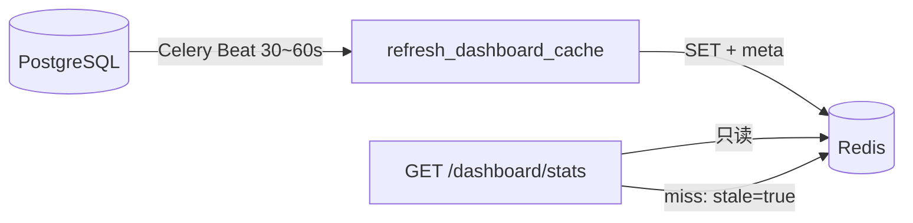

# SOAR 数据库连接与并发优化方案

> 文档类型：架构/运维治理（长期）  
> 更新时间：2026-11-09  
> 相关提交：`bde8823`（双池隔离）、`b942be3`（短会话与有界并发）

---

## 1. 背景与问题

告警联动链路单次执行包含：规则触发 → 智能体研判（Hermes，多轮 LLM + 工具）→ 设备/封禁 HTTP → 库表落库。耗时常达数十秒至数分钟。

SQLAlchemy `QueuePool` 在 ORM 首次查询后会**占用一条 PostgreSQL 连接**，直至 `commit` / `rollback` / `close`。若在长 I/O 期间持有同一 `Session`，洪峰时会出现：

- 主池或联动池耗尽 → API `get_db` 排队超时，整站不可用；
- 与 Postgres `max_connections` 叠加后跨组件争抢连接。

`bde8823` 已将 API 与联动拆池；本方案在拆池基础上规范**会话生命周期**与**有界并发**，并为后续 **Redis 读缓存**留出扩展点。

---

## 2. 设计原则（长期有效）

| 原则 | 说明 |
|------|------|
| 短会话 | 仅包裹短小读写；预期 >500ms 的外部 I/O 不得持有 Session |
| 池职责分离 | `SessionLocal` → API/管理；`LinkageSessionLocal` → 封禁工作流、研判、联动 enrichment |
| 有界并发 | 并行度可配；低频封禁默认不在途限流 |
| 读写过载分路 | 重聚合统计走 Redis 物化（下一阶段）；明细写仍走 PostgreSQL |
| 失效由写方触发 | 资产索引等由资产模块变更 bump version（后续阶段） |
| 封禁可靠性 | 自动封禁：`record_ban` API 成功后再落库；手动封禁：设备成功才落库（既有逻辑） |

---

## 3. 第一阶段（已完成）

### 3.1 基础设施（`bde8823`）

- 主池 `DB_POOL_SIZE` + `DB_MAX_OVERFLOW`，`pool_recycle=1800`
- 联动专用引擎 `linkage_engine` / `LinkageSessionLocal`
- worker/beat 环境变量缩小池参数，避免超出 `max_connections`
- 节点执行器、告警触发器路由至联动池

### 3.2 短会话与并发（`b942be3`）

**核心模块**

| 模块 | 改动要点 |
|------|----------|
| `app/database.py` | `linkage_db()` / `main_db()`；`close_db_session()` |
| `app/workflow/engine.py` | `run_instance(instance_id)` 按节点三段短会话 |
| `app/workflow/nodes/agent_analyze.py` | 研判前释放连接 |
| `app/workflow/agent_client.py` | 研判独立短会话；日志 `linkage_db` |
| `app/workflow/nodes/ban_executor.py` | 先 `record_ban` HTTP，再短会话落库 |
| `app/devices/action_executor.py` | HTTP 前关闭会话；`DeviceCallLog` 独立短会话 |
| `app/platform/agent_runtime.py` | 联动 channel 下 Hermes 启用 `LinkageSessionLocal` 工厂 |
| `app/agent/hermes/executor.py` | LLM 前 `_release_db_for_io()` |
| `app/agent/hermes/tool_engine.py` | 工具执行借用短会话 |
| `app/workflow/concurrency.py` | Redis 在途计数 `soar:limit:workflow_inflight` |
| `app/workflow/trigger.py` | 多 worker + 在途满时延后重试 |

### 3.3 环境变量

| 变量 | 默认值 | 含义 |
|------|--------|------|
| `DB_POOL_SIZE` / `DB_MAX_OVERFLOW` | 20 / 40（backend） | 主池 |
| `DB_LINKAGE_POOL_SIZE` / `DB_LINKAGE_MAX_OVERFLOW` | 10 / 20 | 联动池 |
| `WORKFLOW_TRIGGER_CONCURRENCY` | `2` | 告警触发消费线程数（进程内） |
| `WORKFLOW_INFLIGHT_LIMIT` | `0` | 全局在途实例上限；**0 = 不限制**（低频自动封禁推荐） |

`docker-compose.yml`（backend-dev）已暴露 `WORKFLOW_TRIGGER_CONCURRENCY`、`WORKFLOW_INFLIGHT_LIMIT`。

### 3.4 告警自动封禁路径（业务不变）

```
告警入库 → 触发 worker → WorkflowInstance
  → agent_analyze → action_branch
      action=ban & need_confirm=false → direct_ban
      action=ban & need_confirm=true  → 审批 → execute_ban
      其他 → monitor（不调封禁 API）
  → ban_client.record_ban → POST {BAN_TOOL_BASE_URL}/ban/record-ban（最多 4 次重试）
  → 成功后写 BanRecord / BannedIP
```

**生产必配**：`BAN_ANALYST_AGENT_ID`、`BAN_TOOL_BASE_URL`（真实封禁服务，非无意 mock）。

### 3.5 验收建议

- 模拟并发研判时，主池 checkedout 中位保持较低；
- 自动封禁端到端：实例节点含 `direct_ban`，日志有 `封禁下发成功: record_id=...`；
- `WORKFLOW_INFLIGHT_LIMIT=0` 时不因在途上限丢弃封禁。

---

## 4. 第二阶段（已完成）：大屏 Redis 快照

### 4.1 目标

- 大屏/监控类接口 P95 < 200ms（命中缓存）；
- 请求线程**禁止** `.all()` 拉 7 天明细再 Python 聚合；
- 多 backend 副本共享同一份统计快照。

### 4.2 适用接口（首批）

| HTTP | 说明 | 建议 TTL |
|------|------|----------|
| `GET /dashboard/stats` | 7 天 KPI、趋势、分类、Top IP | 30～60s |
| `GET /dashboard/ai-usage` | 模型/智能体用量 | 60s |
| `GET /ban-workflow/stats` | 工作台今日统计 | 15～30s |
| `GET /executions/stats/overview` | 执行监测概览 | 60s |
| `GET /monitor/overview` | 监控卡片 | 30s |

后续可扩展 `GET /log-center/stats` 等同类聚合接口。

### 4.3 Redis 键与结构

```
soar:cache:dashboard:stats:7d          # JSON，与 get_dashboard_stats 响应同结构
soar:cache:dashboard:stats:7d:meta   # { "built_at", "version", "stale" }
soar:cache:dashboard:ai-usage:{days}
soar:cache:ban_workflow:stats:today
soar:cache:executions:overview:{days}
soar:lock:refresh:dashboard:stats:7d # SETNX 单飞锁，防击穿
```

**一致性约定**：展示延迟 ≤ 60s；前端或接口返回 `meta.built_at` 供标注「统计截至时间」。

### 4.4 刷新机制（Beat 可选）

除 Celery Beat 外，**backend API 进程**默认开启 ``DASHBOARD_BACKEND_REFRESH=true``：内嵌守护线程按 TTL 写 Redis、约 15 分钟 rollup 日表；**部署命令不变**（只起 backend 亦可预热）。与 Beat 并存时 Redis 单飞锁去重。

### 4.4.1 原 Beat 流程



**实现要点**

1. **Celery Beat 定时任务**（或 `asyncio` 后台 + APScheduler，与现有 beat 统一）：
   - 优先 SQL `GROUP BY` / 聚合查询，避免拉全量 `Execution` 行；
   - 写 Redis 时同时更新 `meta.built_at`、`version`（单调递增整数即可）。

2. **API 读路径**（`dashboard.py` 等）：
   - 命中：直接 `json.loads` 返回；
   - 未命中/Redis 故障：返回**上一份快照** + `stale: true`，**禁止**现场全表扫描（可记录告警日志）。

3. **单飞锁**：刷新任务 `SET soar:lock:refresh:... NX EX 120`，避免多 worker 重复计算。

4. **演进（可选）**：今日 KPI 用告警/封禁事件 `INCR` 增量更新，Beat 做对账校正。

### 4.5 代码落点（已落地）

| 新增/修改 | 路径 |
|-----------|------|
| 聚合计算 | `backend/app/core/dashboard_stats.py` |
| 刷新任务 | `backend/app/tasks/dashboard_cache_tasks.py`（`refresh_dashboard_cache`，Beat 60s） |
| Beat 注册 | `backend/app/core/celery_app.py` |
| 缓存读写封装 | `backend/app/core/dashboard_cache.py` |
| API 改造 | `dashboard.py`、`ban_workflow.py`（stats）、`executions.py`（无 workflow 过滤时）、`monitor.py`（overview） |
| 配置 | `DASHBOARD_CACHE_ENABLED`（默认 true）、`DASHBOARD_CACHE_TTL_SEC`（默认 60） |

API 响应可增加顶层 ``cache`` 字段（``built_at`` / ``stale`` / ``version``），前端可标注统计截至时间。

### 4.6 第二阶段验收

- 10 客户端 5s 轮询 `/dashboard/stats`，Postgres QPS 不随客户端线性增长；
- Redis 不可用时 API 仍返回 `stale` 旧快照，错误率可控；
- 压测下 P95 达标。

### 4.7 与并发优化的关系

Redis 快照**不替代**短会话与双池；二者正交：连接治理保联动/API 可用，读缓存降低主池只读压力。

---

## 5. 第三阶段（已完成）

### 5.1 资产 Redis 索引（已落地）

- 键：`soar:asset:index:version`、`soar:asset:index:data`、`soar:lock:refresh:asset:index`
- 写：`assets` CRUD 仍调 `invalidate_asset_index()` → **INCR 版本**
- 读：`ensure_asset_index(db)`（告警富化 `AssetLibEnricher`、工单清单匹配共用）优先拉 Redis 快照，单写者重建
- 配置：`ASSET_INDEX_REDIS_ENABLED`（默认 true）

### 5.2 日汇总表（已落地）

- 表：`stats_daily_executions`、`stats_daily_execution_dims`、`stats_daily_model_calls`、`stats_daily_model_call_dims`
- Beat：`rollup_daily_stats` 每 15 分钟滚动重算最近 `DAILY_STATS_ROLLUP_DAYS`（默认 8）天
- 读：`compute_dashboard_stats` / `compute_ai_usage_stats`（7 天）在日汇总齐全时优先读表，否则回退原全量路径
- 配置：`DAILY_STATS_ENABLED`（默认 true）

详见正式方案讨论记录；本文以第二阶段为大屏落地执行单。

---

## 6. 运维速查

```bash
# 低频自动封禁（推荐）
WORKFLOW_INFLIGHT_LIMIT=0
WORKFLOW_TRIGGER_CONCURRENCY=1   # 或 2

# 告警风暴时可选开启在途上限（延后执行，非丢弃）
WORKFLOW_INFLIGHT_LIMIT=12

# 自动封禁 API
BAN_TOOL_BASE_URL=https://<封禁服务>/api/v1/internal
BAN_ANALYST_AGENT_ID=<智能体 ID>
```

**监控建议**：主池/联动池 checkedout；`pg_stat_activity` 中 `idle in transaction` > 30s；Redis 键 `soar:limit:workflow_inflight`；封禁日志 `record_id`。

---

## 7. 文档修订记录

| 日期 | 说明 |
|------|------|
| 2026-11-09 | 初稿：第一阶段落地说明 + 第二阶段大屏 Redis 快照执行单 |
| 2026-11-09 | 第二阶段落地：Redis 快照 + Beat 刷新 + 首批 API 读缓存 |
| 2026-11-09 | 第三阶段（资产）：Redis 版本化索引 + ensure_asset_index |
| 2026-11-09 | 第三阶段（日汇总）：stats_daily_* + Beat rollup + 大屏读表 |
