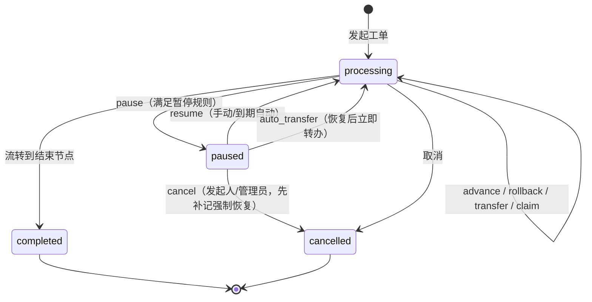
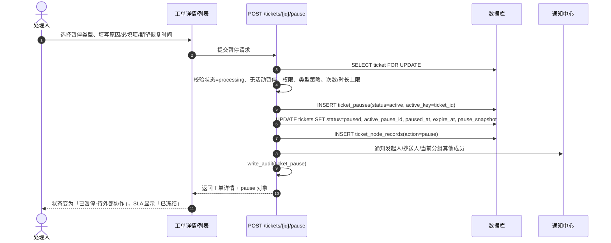

# 工单暂停（临时挂起）处理方案

> 适用范围：工单中心 / 工单监控大屏 / 工单配置
> 关联基线：`backend/app/models/ticket.py`、`backend/app/api/v1/tickets.py`、`backend/app/core/ticket_sla.py`、`backend/app/tasks/ticket_tasks.py`、`frontend/src/pages/TicketCenter.jsx`、`frontend/src/pages/TicketDetail.jsx`
> 目标：在不破坏现有"节点流转 + 先到先得 + 并行会签 + SLA + 超时提醒"能力的前提下，增加可配置、可审计、可自动兜底的暂停能力。

---

## 1. 设计目标与边界

### 1.1 目标

1. 处理人在工单无法继续推进时，可显式挂起工单，状态、归属、计时、通知全部可追踪。
2. 暂停按业务原因分类，不同类型拥有独立的时效、提醒、超时处置策略。
3. 暂停期间冻结 SLA 与节点停留计时，暂停时长不计入处理绩效，避免"客观等待"被判超时。
4. 任何暂停都必须能在有限时间内闭环：到期提醒 → 自动恢复 → 升级兜底，不允许无限期挂起。
5. 列表、详情、大屏、报表、导出、权限、审计全部支持暂停态，且语义一致。

### 1.2 边界

- 本期暂停粒度为**整张工单**，不支持"仅暂停并行会签中的某一个分组"。
- 暂停不改变当前节点、不改变流程快照、不触发路由判断。
- 暂停不替代回退/转办/取消：暂停是"原地等待"，不是流程分支。
- 暂停期间禁止流转、回退、转办、设备动作、认领；允许评论、查看、追加抄送、取消（由发起人/管理员）。

### 1.3 关键设计决策

| 决策 | 结论 | 理由 |
| --- | --- | --- |
| 状态表达 | 新增显式状态 `paused`，不使用布尔标记 | 列表筛选、统计、权限判断语义明确；避免 `status=processing and is_paused` 组合条件扩散 |
| 暂停记录 | 独立表 `ticket_pauses`，每次暂停一条 | 支持多次暂停、历史追溯、时长统计、批量追溯 |
| 计时口径 | 暂停时长从 SLA 与节点停留时长中扣除 | 等待外部因素不应计入处理时效 |
| 到期处置 | 默认自动恢复，可配置升级/转办/自动关闭 | 保证暂停一定闭环，避免"僵尸工单" |
| 暂停配置来源 | 系统级配置快照到暂停记录 | 暂停执行后配置变更不影响在途暂停，行为可复现 |

---

## 2. 现状基线与改造点

### 2.1 现状

- 工单状态仅 `processing / completed / cancelled`，见 `Ticket.status`。
- 权限模型：`ticket: ["view", "edit", "delete", "execute"]`。
- 节点停留超时由 Celery beat 每 5 分钟执行 `scan_ticket_timeouts`，按模板节点 `timeout_minutes / remind_interval_minutes` 提醒当前分组。
- SLA 由 `ticket_sla.py` 按优先级计算响应/解决目标，当前按自然时间计算。
- 流转、回退、转办、认领、设备动作均以 `status == "processing"` 作为前置校验。
- 列表视图：`my_pending / created / handled / cc / all`，默认排除归档。

### 2.2 改造点清单

| 层 | 文件 | 改造内容 |
| --- | --- | --- |
| 模型 | `backend/app/models/ticket.py` | `Ticket` 增加暂停字段；新增 `TicketPause` 模型 |
| 校验 | `backend/app/schemas/ticket.py` | 新增暂停/恢复/批量/配置请求模型 |
| 核心逻辑 | `backend/app/core/ticket_pause.py`（新增） | 暂停领域服务：校验、创建、恢复、到期处置、计时折算 |
| SLA | `backend/app/core/ticket_sla.py` | 有效时长扣除暂停区间 |
| 接口 | `backend/app/api/v1/tickets.py` | 暂停/恢复/批量/配置接口；所有流转类接口增加暂停拦截；列表/导出/大屏适配 |
| 定时任务 | `backend/app/tasks/ticket_pause_tasks.py`（新增）、`tasks/__init__.py`、`core/celery_app.py` | 暂停到期提醒与自动处置扫描 |
| 迁移 | `backend/app/core/security.py` | `tickets` 补列、`ticket_pauses` 建表与索引 |
| 权限 | `backend/app/core/permissions.py` | `ticket` 增加 `pause` 动作 |
| 前端 | `frontend/src/api/tickets.js`、`TicketCenter.jsx`、`TicketDetail.jsx`、`TicketMonitorScreen.jsx` | 入口、状态展示、筛选、批量、配置 |

---

## 3. 领域模型

### 3.1 状态机



约束：

- `paused` 只能由 `processing` 进入，且同一工单同时最多一个活动暂停（数据库唯一约束保证）。
- `paused` 不能直接流转/回退/转办/认领/执行设备动作。
- `completed / cancelled` 不允许暂停。
- 暂停期间取消：先写入一条 `resume` 记录（`mode=force`），再写入 `cancel` 记录，保证时间线完整。

### 3.2 暂停分类定义

| 编码 | 名称 | 典型场景 | 必填信息 | 默认最长 | 到期策略 |
| --- | --- | --- | --- | --- | --- |
| `pending_info` | 待补充信息 | 缺少账号、资产归属、影响范围等，需发起人或业务方补充 | 补充事项、期望回复时间 | 24h | 自动恢复 + 通知 |
| `external_coop` | 待外部协作 | 等待厂商、运营商、第三方平台处置或回执 | 协作方、联系人、协作单号（可选）、期望时间 | 72h | 自动恢复 + 升级管理员 |
| `user_feedback` | 待用户反馈 | 需业务用户确认是否误报、是否可封禁 | 待确认事项、期望时间 | 48h | 自动恢复 + 通知发起人/抄送人 |
| `business_window` | 待变更窗口 | 需等待停机窗口、业务低峰期再执行处置 | 窗口开始/结束时间 | 168h | 自动恢复 + 通知 |
| `duplicate_merge` | 重复工单待合并 | 与既有工单重复，等待确认主单 | 主工单号、合并说明 | 24h | 自动恢复；开启 `auto_close` 时自动取消 |
| `other` | 其他 | 无法归类的临时挂起 | 详细原因 + 附件（可选） | 8h | 自动恢复 + 升级管理员 |

分类判定规则：

- 暂停类型由操作人**显式选择**，系统按类型校验必填信息，不做自动推断。
- `critical` 优先级工单暂停时，若操作人非管理员，必须填写"暂停必要性说明"，且 `pending_info / duplicate_merge` 类型仅管理员可发起（防止高优工单被处理人自行挂起）。
- `duplicate_merge` 必须填写主工单号，且主工单不能是自身、不能已取消。
- 类型不可用时（配置 `enabled=false`）前端隐藏，后端返回 422。

### 3.3 数据模型

#### 3.3.1 `tickets` 新增字段

```sql
ALTER TABLE tickets ADD COLUMN pause_type VARCHAR(32);
ALTER TABLE tickets ADD COLUMN active_pause_id INTEGER;
ALTER TABLE tickets ADD COLUMN paused_at TIMESTAMP WITHOUT TIME ZONE;
ALTER TABLE tickets ADD COLUMN pause_expire_at TIMESTAMP WITHOUT TIME ZONE;
ALTER TABLE tickets ADD COLUMN paused_by_id INTEGER;
ALTER TABLE tickets ADD COLUMN paused_by_name VARCHAR(64) DEFAULT '';
ALTER TABLE tickets ADD COLUMN pause_count INTEGER NOT NULL DEFAULT 0;
ALTER TABLE tickets ADD COLUMN pause_total_minutes INTEGER NOT NULL DEFAULT 0;
ALTER TABLE tickets ADD COLUMN pause_snapshot JSON;
CREATE INDEX ix_tickets_status_pause_expire ON tickets (status, pause_expire_at);
```

字段语义：

| 字段 | 语义 |
| --- | --- |
| `pause_type` | 当前/最近一次暂停类型（恢复后保留，供列表展示"曾暂停"） |
| `active_pause_id` | 活动暂停记录 ID，NULL 表示未暂停；唯一性由 `ticket_pauses.active_key` 保证 |
| `paused_at` | 本次暂停开始时间 |
| `pause_expire_at` | 本次暂停到期时间（已按类型上限与系统硬上限裁剪） |
| `paused_by_*` | 暂停操作人快照 |
| `pause_count` | 累计暂停次数 |
| `pause_total_minutes` | 累计已恢复的暂停分钟数（不含当前活动暂停） |
| `pause_snapshot` | 暂停瞬间的节点/分组/认领人/`arrived_at` 快照，用于恢复与冲突检测 |

#### 3.3.2 `ticket_pauses`

| 字段 | 类型 | 说明 |
| --- | --- | --- |
| `id` | INTEGER PK | |
| `ticket_id` | INTEGER FK, index | 工单 |
| `pause_no` | INTEGER | 本工单第几次暂停（从 1 开始） |
| `pause_type` | VARCHAR(32) | 分类编码 |
| `reason` | TEXT | 暂停原因（必填） |
| `detail` | JSON | 分类必填项（补充事项/协作方/主工单号/窗口时间等） |
| `status` | VARCHAR(16) | `active / resumed / expired / cancelled` |
| `active_key` | INTEGER NULL UNIQUE | 活动时为 `ticket_id`，非活动为 NULL；MySQL/PG 均允许多个 NULL，保证"一单一个活动暂停" |
| `paused_by_id` / `paused_by_name` | INTEGER / VARCHAR(64) | 操作人 |
| `paused_at` | TIMESTAMP | 开始时间 |
| `expected_resume_at` | TIMESTAMP NULL | 操作人期望恢复时间 |
| `expire_at` | TIMESTAMP | 系统到期时间 |
| `resumed_at` | TIMESTAMP NULL | 实际恢复时间 |
| `resumed_by_id` / `resumed_by_name` | INTEGER / VARCHAR(64) | 恢复操作人（系统为 NULL + `resume_mode=auto`） |
| `resume_mode` | VARCHAR(16) NULL | `manual / auto / timeout / force` |
| `duration_minutes` | INTEGER NULL | 实际暂停分钟数 |
| `remind_stage` | INTEGER NOT NULL DEFAULT 0 | 已发送提醒阶段（0/1/2/3），幂等 |
| `last_reminded_at` | TIMESTAMP NULL | 最近提醒时间 |
| `policy_snapshot` | JSON | 暂停时的类型策略快照 |
| `batch_id` | VARCHAR(64) NULL | 批量操作批次 |
| `conflict_flag` | BOOLEAN DEFAULT FALSE | 恢复时检测到归属变更 |
| `related_ticket_id` | INTEGER NULL | 重复工单指向的主工单 |
| `created_at` / `updated_at` | TIMESTAMP | |

索引：

```sql
CREATE INDEX ix_ticket_pauses_ticket ON ticket_pauses (ticket_id, id);
CREATE INDEX ix_ticket_pauses_status_expire ON ticket_pauses (status, expire_at);
CREATE UNIQUE INDEX uq_ticket_pauses_active ON ticket_pauses (active_key);
```

#### 3.3.3 时间线扩展

`TicketNodeRecord.action` 新增：`pause / resume / pause_remind / pause_expire / batch_pause / batch_resume`。
其中 `pause_remind` 只写时间线不写节点进度；`pause_expire` 记录系统自动处置结果。

---

## 4. 全流程设计

### 4.1 触发条件

| 触发方式 | 条件 | 说明 |
| --- | --- | --- |
| 手动暂停 | 工单 `processing`，操作人有暂停权限，类型可用，未超过次数/时长限制 | 主路径 |
| 批量暂停 | 满足手动暂停条件，且具备批量权限，单批 ≤ 200 | 管理场景 |
| 外部同步暂停 | 开放平台/外部系统回调将工单置为暂停 | 需 `ticket:edit` 且类型白名单允许外部触发 |
| 自动暂停 | 节点停留超时且模板开启 `auto_pause_on_timeout` | 默认关闭，按需启用 |

禁止暂停的场景：

- 工单已 `completed / cancelled / archived`。
- 工单已处于 `paused`：幂等返回已有暂停记录（HTTP 200），不产生新记录。
- 工单在 5 分钟内刚被恢复又暂停：允许，但计入 `pause_count`。
- 当前存在未完成的设备动作执行（`queued/running`）：允许暂停，但在途动作继续执行，时间线提示；恢复前不得发起补偿。

### 4.2 操作入口

| 入口 | 位置 | 说明 |
| --- | --- | --- |
| 单条暂停 | 工单列表行操作「暂停」 | 仅 `processing` 且有权显示 |
| 单条暂停 | 工单详情右上角操作组 | 与「转办/回退/取消」同组 |
| 单条恢复 | 列表/详情「恢复」 | 仅 `paused` 且有权 |
| 批量暂停/恢复 | 列表勾选后批量工具栏 | 管理员与具备 `ticket:pause` 的角色 |
| 暂停视图 | 状态筛选「已暂停」 | 支持按类型、到期时间排序 |
| 通知直达 | 通知中心消息点击 | 跳转工单详情并高亮暂停信息 |
| 配置入口 | 工单配置 → 暂停策略 | 类型启停、时效、提醒、到期动作 |

### 4.3 暂停执行时序



事务与并发：

1. `_get_ticket_or_404(..., for_update=True)` 行锁，串行化同一工单的暂停/恢复/流转。
2. 创建 `ticket_pauses` 时依赖 `active_key` 唯一索引兜底：并发重复暂停时第二笔触发 `IntegrityError`，捕获后查询现有活动暂停并幂等返回。
3. 所有时间写入统一使用 `beijing_now()`，与现有工单时间口径一致。

### 4.4 恢复机制

| 恢复方式 | 触发者 | 条件 | 行为 |
| --- | --- | --- | --- |
| 手动恢复 | 暂停发起人 / 当前节点处理人 / 发起人 / 管理员 | 工单 `paused` | 写入 `resume`，回到原节点原地继续 |
| 到期自动恢复 | 定时任务 | `now >= expire_at` | 系统身份恢复，`resume_mode=timeout` |
| 管理员强制恢复 | 管理员 | 任意 `paused` | 忽略暂停人限制，`resume_mode=force`，必填原因 |
| 恢复并转办 | 管理员 | `paused` 且配置兜底分组 | 先恢复再转办，两步同一事务，时间线两条记录 |
| 恢复并取消 | 发起人 / 管理员 | `paused` | 先强制恢复再取消，避免状态跳跃 |

恢复事务步骤：

1. 锁定工单，校验 `status == paused` 且 `active_pause_id == 请求 pause_id`（防陈旧请求）。
2. 计算 `duration = now - paused_at`，更新 `ticket_pauses`：`status=resumed`、`resumed_at`、`duration_minutes`、`resume_mode`、`resumed_by_*`、`active_key=NULL`。
3. 更新工单：
   - `status = processing`
   - `active_pause_id = NULL`，`pause_type` 保留，`paused_at = NULL`，`pause_expire_at = NULL`
   - `pause_total_minutes += duration`
   - `arrived_at += duration`（节点停留计时冻结后移；`arrived_at` 为空时置为 `now`）
   - `first_reminded_at / last_reminded_at = NULL`，`remind_count = 0`（避免恢复瞬间立即重复提醒）
4. 归属冲突检测：对比 `pause_snapshot` 与当前 `current_group_ids / claimed_by_id`；不一致则 `conflict_flag=true`，时间线与通知中标注"暂停期间归属已变更，按当前归属继续"。
5. 写入 `resume` 时间线、通知、审计。
6. 若配置了恢复即转办，紧接执行转办逻辑（复用现有转办校验）。

### 4.5 通知机制

统一复用 `_notify_user_ids`（站内通知中心），通知对象按事件计算，去重并排除操作人本人。

| 事件 | 通知对象 | 标题模板 | 频率 |
| --- | --- | --- | --- |
| 暂停 | 发起人、抄送人、当前分组其他成员、认领人 | `工单已暂停：{ticket_no}` | 每次暂停 |
| 暂停（用户反馈类） | 额外通知发起人并置顶 | `工单等待您反馈：{ticket_no}` | 每次 |
| 到期前提醒 | 暂停操作人、当前处理人 | `工单暂停即将到期：{ticket_no}` | 50%/80% 各一次 |
| 到期自动恢复 | 全体参与者 | `工单已自动恢复：{ticket_no}` | 一次 |
| 到期升级 | 全部管理员 | `工单暂停超期需介入：{ticket_no}` | 一次 |
| 恢复 | 发起人、抄送人、当前分组成员 | `工单已恢复：{ticket_no}` | 每次 |
| 批量操作完成 | 操作人 | `批量暂停完成：成功 X / 失败 Y` | 每批一次 |

通知内容必须包含：工单编号、标题、暂停类型、暂停原因摘要、暂停人、到期时间、可点击跳转链接。

限频与幂等：同一暂停记录同一 `remind_stage` 只发一次；批量操作合并为一条汇总通知，不逐单轰炸。

---

## 5. 系统约束

### 5.1 最长暂停时效

| 层级 | 规则 | 默认值 |
| --- | --- | --- |
| 单次暂停 | `expire_at = paused_at + min(类型 max_minutes, 系统 max_pause_minutes)` | 按类型 8h～168h |
| 系统硬上限 | 任何工单单次暂停不得超过 | 168h（7 天） |
| 累计暂停 | `pause_total_minutes + 当前暂停时长` 不得超过系统累计上限 | 336h（14 天） |
| 暂停次数 | 单工单累计暂停次数上限，超过后仅管理员可暂停 | 5 次 |
| 期望恢复时间 | 操作人填写值不得超过 `expire_at`，超出则截断并提示 | — |

超限处理：暂停接口返回 `422`，错误码 `PAUSE_EXCEEDS_LIMIT`，前端提示"该类型最长可暂停 X 小时，已按上限设置"或"累计暂停已达上限，请联系管理员"。

### 5.2 自动提醒机制

- 扫描任务 `scan_ticket_pauses` 每 5 分钟执行一次，与 `scan_ticket_timeouts` 并列注册。
- 提醒阶段（写入 `remind_stage`，保证幂等）：
  - stage 1：达到暂停总时长的 50%
  - stage 2：达到暂停总时长的 80%
  - stage 3：`expire_at - 4h` 的到期预警（若与 stage 2 重合则合并）
- 提醒对象：暂停操作人、当前节点处理人；用户反馈型额外提醒发起人。
- 提醒同时写入时间线 `pause_remind`，并在列表标记 `pause_expiring`（剩余 ≤ 4h）。
- 暂停中的工单**不参与**节点停留超时提醒（`scan_ticket_timeouts` 跳过 `status=paused`），避免双重提醒。

### 5.3 超时自动流转规则

到期处置按类型策略执行，全部由 `scan_ticket_pauses` 驱动：

| 策略 | 行为 | 适用类型 |
| --- | --- | --- |
| `auto_resume` | 到期自动恢复，通知全体参与者 | `pending_info`、`business_window` |
| `auto_resume_escalate` | 到期恢复，同时通知全部管理员 | `external_coop`、`other` |
| `auto_transfer` | 到期恢复后转办至配置的兜底分组；未配置则降级为 `auto_resume_escalate` | 可选 |
| `auto_close` | 到期恢复后自动取消（仅重复工单，且必须显式开启） | `duplicate_merge`（可选） |

兜底：若自动恢复因数据冲突失败（如节点定义缺失、分组被删除），任务捕获异常并将暂停标记为 `expired`、工单保持 `paused`，同时升级管理员并在系统监控中告警；管理员强制恢复后闭环。

### 5.4 计时口径

**SLA（响应/解决）**

```
有效时长 = 自然时长 - 与该区间重叠的暂停时长
```

- 响应时长：发起 → 首次 submit，扣除期间暂停。
- 解决时长：创建 → 关闭，扣除期间全部暂停。
- 工单处于暂停中时，SLA 剩余时间冻结（`now` 按 `paused_at` 计算）。
- 暂停结束恢复后，剩余时间自动增加相应暂停时长。
- 修改点：`ticket_sla.evaluate_ticket_sla` 与 `tickets._sla_remaining` 共用新的 `effective_minutes()`；导出/大屏同口径。

**节点停留时长**

- 暂停期间不计入节点停留。
- 恢复时 `arrived_at += 暂停时长`，并重置节点提醒进度，避免恢复即判定超时。

**统计口径**

- "今日新增"按 `created_at`，不受暂停影响。
- "今日关闭"按 `closed_at`，不受暂停影响。
- "处理中"拆分为"活跃处理中"与"暂停中"，两者之和为"未完结"。

---

## 6. 权限与可见范围

### 6.1 权限模型

在 `permissions.py` 的 `ticket` 模块新增动作 `pause`：

```python
"ticket": ["view", "edit", "delete", "execute", "pause"],
```

- `ticket:pause` 控制暂停/恢复/批量操作入口。
- 管理员（`is_admin`）不受动作限制。
- 流程模板/系统配置中的暂停策略属于 `ticket_config:edit`。

### 6.2 角色操作矩阵

| 操作 | 当前处理人（组员/认领人） | 发起人 | 抄送人 | 管理员 | 无关联用户 |
| --- | --- | --- | --- | --- | --- |
| 查看工单 | ✅（属于待处理分组） | ✅ | ✅ | ✅ | ❌ |
| 查看暂停原因 | ✅ | ✅ | 按类型可见性 | ✅ | ❌ |
| 发起暂停 | ✅（受限类型） | 仅 `user_feedback / duplicate_merge` | ❌ | ✅ | ❌ |
| 手动恢复 | ✅ | ✅（其发起的暂停或用户反馈类） | ❌ | ✅ | ❌ |
| 强制恢复 | ❌ | ❌ | ❌ | ✅ | ❌ |
| 暂停中取消 | ❌ | ✅ | ❌ | ✅ | ❌ |
| 暂停中评论/追加抄送 | ✅ | ✅ | ❌ | ✅ | ❌ |
| 暂停中流转/回退/转办/认领/设备动作 | ❌ | ❌ | ❌ | ❌（需先恢复） | ❌ |
| 批量暂停/恢复 | 仅本人可见范围内 | ❌ | ❌ | ✅ | ❌ |
| 修改暂停策略 | ❌ | ❌ | ❌ | ✅（`ticket_config:edit`） | ❌ |

### 6.3 可见范围

| 视图 | 是否包含暂停工单 | 说明 |
| --- | --- | --- |
| 待我处理 | ✅ 默认包含 | 暂停工单置灰并显示"已暂停"标签；提供"仅看活跃"开关排除 |
| 我发起的 | ✅ | 展示暂停类型与到期时间 |
| 我处理过的 | ✅ | 含已恢复记录 |
| 抄送我的 | ✅ | 原因可见性按类型策略 |
| 全部 | ✅ | 需 `ticket:view` |
| 已暂停专用视图 | ✅ | 支持类型、到期时间、超期状态筛选 |

原因可见性：

- `participants`（默认）：发起人、处理人、抄送人、管理员可见完整原因。
- `internal`：仅处理人与管理员可见；发起人/抄送人看到"已暂停（原因内部可见）"。
- 所有可见性判断在详情接口统一计算，前端不自行裁剪。

---

## 7. 列表 / 详情 / 统计 / 大屏

### 7.1 工单列表

状态元数据新增：

```js
paused: { label: '已暂停', cls: 'bg-amber-500/10 text-amber-500' }
```

展示规则：

- 状态列：`已暂停 · 待外部协作`，附剩余时间（`剩余 6小时` / `已超期 1小时`）。
- 当前节点列：节点名 + 暂停图标；处理人列显示暂停操作人及暂停时间（tooltip 显示原因摘要）。
- SLA 列：显示"已冻结"并给出冻结前的剩余时间；超期暂停显示红色 `暂停超期`。
- 行操作：`暂停` 仅在 `processing` 且有权时出现；`恢复` 仅在 `paused` 且有权时出现；`转办/回退/认领` 置灰并提示"请先恢复工单"。
- 排序：支持按暂停到期时间升序，"即将到期"优先。
- 筛选：状态新增 `paused`；新增暂停类型筛选、`pause_expiring`（4 小时内到期）、`pause_overdue`（已超期）快捷筛选。
- 批量工具栏：勾选含 `paused` 工单时，仅显示与状态匹配的批量操作。

### 7.2 工单详情

- 顶部状态条：琥珀色"已暂停"，展示类型、原因、暂停人、暂停时间、到期倒计时。
- 操作区：`恢复`、`强制恢复`（管理员）、`取消`（发起人/管理员）；隐藏/禁用流转类按钮。
- 时间线：新增 `pause / pause_remind / resume / pause_expire` 节点，展示原因、时长、操作人、恢复方式。
- SLA 卡片：显示"已暂停，计时冻结"，并展示累计暂停时长与次数。
- 页面提示条："工单暂停期间不可流转、回退、转办与执行设备动作"。

### 7.3 统计报表

新增指标：

| 指标 | 定义 |
| --- | --- |
| 暂停中 | `status=paused` 且未归档 |
| 未完结 | `processing + paused` |
| 暂停率 | `暂停中 / 未完结` |
| 平均暂停时长 | 统计周期内已恢复暂停的 `duration_minutes` 均值 |
| 暂停超期数 | 活动暂停中 `expire_at < now` |
| 暂停类型分布 | 按 `pause_type` 分组计数与时长 |
| 暂停后完成率 | 恢复后最终完成的工单 / 恢复工单总数 |

报表口径要求：

- SLA 达成率统一使用扣除暂停后的有效时长。
- 大屏 KPI 增加"暂停中"与"暂停超期"两块，颜色使用琥珀/红色。
- 工单导出新增列：`暂停状态`、`暂停类型`、`暂停开始时间`、`暂停到期时间`、`累计暂停时长`、`暂停次数`、`最近恢复方式`、`暂停操作人`。
- 暂停中工单的"当前节点"导出为 `节点名（已暂停）`。

### 7.4 监控大屏

- KPI 卡片：未完结 = 活跃 + 暂停，暂停单独展示。
- 状态分布图新增"已暂停"扇区。
- 新增"暂停超期 TopN"列表，展示编号、类型、暂停时长、超期时长。
- 大屏轮询使用轻量聚合，暂停统计走独立 `count` 查询，不加载全量关联记录。

---

## 8. 异常场景处理预案

### 8.1 暂停期间被重复分配

| 场景 | 检测 | 处理 |
| --- | --- | --- |
| 人工转办/认领/流转 | 接口前置校验 `status != processing` | 返回 `409 TICKET_PAUSED`，提示"请先恢复工单" |
| 外部系统/开放平台改派 | 开放平台接口统一校验暂停状态 | 拒绝并记录审计，返回明确错误码 |
| 并发竞态（暂停与转办同时提交） | 行锁 + `active_pause_id` 条件更新 | 后到者失败重试；若转办先成功，暂停请求重新校验归属后决定是否允许 |
| 暂停期间数据已被改写（历史脏数据） | 恢复时对比 `pause_snapshot` | 标记 `conflict_flag=true`，按当前归属继续，通知原处理人与管理员 |

兜底 SQL 条件更新示例：

```sql
UPDATE tickets SET ... WHERE id = :id AND status = 'processing' AND active_pause_id IS NULL;
```

### 8.2 暂停状态下的权限变更

| 场景 | 影响 | 处理 |
| --- | --- | --- |
| 暂停人被禁用/删除 | 无人手动恢复 | 组内成员、发起人、管理员均可恢复；到期自动恢复不依赖账号状态 |
| 当前分组被禁用或无成员 | 恢复后无人处理 | 恢复时检测分组有效性，无效则升级管理员并标记 `resume_blocked`；配置允许时自动转办兜底分组 |
| 用户被移除分组 | 可见性变化 | 实时按当前分组计算；已产生的暂停记录与历史时间线保留 |
| 角色权限被回收 | 无法操作 | 恢复接口返回 403；到期自动处置仍执行（系统身份） |
| 发起人被禁用 | 无法取消/恢复 | 管理员可强制恢复或取消 |
| 暂停期间角色权限配置变更 | 新权限即时生效 | 不做回溯，审计记录权限变更与操作结果 |

### 8.3 批量暂停 / 批量恢复规范

- 单批上限 200 条；超过则提示分批或转异步任务（>50 条默认异步 + 进度查询）。
- 执行模式：默认"逐单校验、部分成功"，返回 `success / skipped / failed` 三类明细及原因。
- 幂等：`batch_id + ticket_id` 唯一；重复提交返回首次结果。
- 权限：逐单校验，不做"一张有权全批放行"；越权项计入 `skipped`。
- 状态冲突：已暂停的工单批量暂停时计入 `skipped (already_paused)`；非暂停工单批量恢复时同理。
- 事务：逐单独立事务，避免单条失败回滚整批。
- 审计：一次批量操作写一条汇总审计，明细存入 `detail.results`；单条工单时间线各写一条 `batch_pause / batch_resume`。
- 通知：操作人收一条汇总通知；工单参与者按单条规则通知，但 5 分钟内同类通知合并。

### 8.4 其他异常

| 异常 | 处理 |
| --- | --- |
| 重复暂停请求 | 幂等返回当前活动暂停（200），不新增记录 |
| 重复恢复请求 | 返回 `409 TICKET_NOT_PAUSED`，前端刷新详情 |
| 暂停中流程模板被修改/发布 | 工单使用快照，不受影响；暂停策略使用暂停时的 `policy_snapshot` |
| 暂停中暂停策略配置变更 | 在途暂停不生效，新暂停使用新配置 |
| 暂停中设备动作仍在执行 | 允许其在途完成；结果正常写入时间线；补偿需恢复后操作 |
| 暂停中追加/移除抄送 | 允许；新增抄送人收到抄送通知，不触发暂停通知 |
| 暂停中工单被归档/删除 | 禁止归档；删除仅 `ticket:delete`，需先恢复，删除时级联清理 `ticket_pauses` |
| 暂停到期时数据库异常 | 任务记录失败并重试；连续失败 3 次升级管理员并告警 |
| 时区/夏令时 | 全链路使用 `beijing_now()` 与统一序列化，不引入本地时区 |
| 工单编号重复/并发发起 | 沿用现有 `_gen_ticket_no` 冲突重试机制，暂停逻辑不受影响 |

---

## 9. 接口设计

### 9.1 单条暂停

`POST /api/v1/tickets/{ticket_id}/pause`

```json
{
  "pause_type": "external_coop",
  "reason": "等待运营商回执封堵结果",
  "expected_resume_at": "2026-11-07T18:00:00+08:00",
  "detail": {
    "partner": "中国电信",
    "contact": "张工",
    "coop_ticket_no": "DX20261106001"
  },
  "attachments": []
}
```

响应：`200`，返回 `_ticket_detail` 结构 + `pause` 对象。
错误：`403`（无权限/类型不允许）、`409 TICKET_PAUSED`（已暂停，幂等返回）、`422 PAUSE_EXCEEDS_LIMIT`（超限）、`400`（状态不允许）。

### 9.2 恢复

`POST /api/v1/tickets/{ticket_id}/resume`

```json
{ "comment": "已收到运营商回执", "force": false, "transfer_to_group_id": null }
```

- `force=true` 仅管理员可用。
- `transfer_to_group_id` 非空时，恢复后同事务转办。

### 9.3 批量

- `POST /api/v1/tickets/batch/pause`
  ```json
  { "ticket_ids": [1, 2, 3], "pause_type": "pending_info", "reason": "...", "expected_resume_at": null }
  ```
- `POST /api/v1/tickets/batch/resume`
  ```json
  { "ticket_ids": [1, 2, 3], "comment": "..." }
  ```
- 响应：
  ```json
  {
    "batch_id": "bp-20261106-0001",
    "total": 3,
    "success": 2,
    "skipped": 1,
    "failed": 0,
    "results": [
      { "ticket_id": 1, "result": "success" },
      { "ticket_id": 2, "result": "success" },
      { "ticket_id": 3, "result": "skipped", "reason": "already_paused" }
    ]
  }
  ```

### 9.4 查询与配置

- `GET /api/v1/tickets?status=paused&pause_type=external_coop&pause_expiring=true`
- `GET /api/v1/tickets/pauses?status=active&overdue=true&page=1&size=20`
- `GET /api/v1/tickets/pause-config`（`ticket_config:view`）
- `PUT /api/v1/tickets/pause-config`（`ticket_config:edit`）

配置结构（`SystemConfig` 键 `ticket.pause_config`）：

```json
{
  "enabled": true,
  "max_pause_minutes": 10080,
  "max_total_pause_minutes": 20160,
  "max_pause_count": 5,
  "max_batch_size": 200,
  "remind_before_expire_minutes": 240,
  "fallback_group_id": 3,
  "types": {
    "pending_info": {
      "label": "待补充信息",
      "enabled": true,
      "max_minutes": 1440,
      "allow_roles": ["handler", "admin"],
      "require_expected_resume": true,
      "remind_percents": [50, 80],
      "timeout_policy": "auto_resume",
      "release_claim": false,
      "reason_visibility": "participants",
      "allow_batch": true,
      "auto_close": false
    },
    "external_coop": {
      "label": "待外部协作",
      "enabled": true,
      "max_minutes": 4320,
      "allow_roles": ["handler", "admin"],
      "require_expected_resume": true,
      "remind_percents": [50, 80],
      "timeout_policy": "auto_resume_escalate",
      "release_claim": false,
      "reason_visibility": "internal",
      "allow_batch": true,
      "auto_close": false
    }
  }
}
```

校验规则：`max_minutes` 正数且不超过系统硬上限；`remind_percents` 升序且在 1～99 之间；`timeout_policy` 枚举合法；`fallback_group_id` 必须存在且启用。

### 9.5 错误码

| 错误码 | HTTP | 含义 |
| --- | --- | --- |
| `TICKET_PAUSED` | 409 | 工单已暂停，操作被拒绝 |
| `TICKET_NOT_PAUSED` | 409 | 工单未暂停 |
| `PAUSE_TYPE_DISABLED` | 422 | 暂停类型不可用 |
| `PAUSE_EXCEEDS_LIMIT` | 422 | 超过单次/累计/次数上限 |
| `PAUSE_FORBIDDEN` | 403 | 无该类型暂停权限 |
| `PAUSE_POLICY_INVALID` | 500/422 | 配置非法或缺失 |

---

## 10. 定时任务改造

新增 `backend/app/tasks/ticket_pause_tasks.py`：

```python
@celery_app.task(name="scan_ticket_pauses")
def scan_ticket_pauses() -> dict:
    """暂停到期提醒与自动处置扫描（每 5 分钟）。"""
```

处理逻辑：

1. 查询 `status=paused` 且 `expire_at` 在阈值内的工单，按 `id` 升序分批（每批 200）。
2. 计算提醒阶段与到期状态，写 `pause_remind` / 触发恢复。
3. 每个工单独立事务提交，单条失败不影响其余。
4. 返回 `{"scanned": n, "reminded": x, "resumed": y, "escalated": z}` 并记录日志。

注册：

```python
"scan-ticket-pauses": {
    "task": "scan_ticket_pauses",
    "schedule": crontab(minute="*/5"),
},
```

同时修改 `scan_ticket_timeouts`：跳过 `status != processing` 的工单（现有查询已过滤 processing，需确认暂停后不重复提醒）。

---

## 11. 实施步骤与验收

### 11.1 实施顺序

1. 数据层：`TicketPause` 模型、`Ticket` 字段、`security.py` 补列与索引。
2. 领域服务：`ticket_pause.py`（配置、创建、恢复、计时折算、权限判定）。
3. 接口层：暂停/恢复/批量/配置；所有流转类接口加 `_assert_not_paused`。
4. SLA 与提醒：`ticket_sla.py`、`tickets.py` 的 `_sla_remaining`、`scan_ticket_pauses`。
5. 列表/详情/大屏/导出适配。
6. 前端入口、弹窗、批量、配置页。
7. 测试与灰度。

### 11.2 验收清单

- [ ] 仅 `processing` 可暂停；重复暂停幂等；`completed/cancelled` 返回明确错误。
- [ ] 六类暂停的必填项、默认时长、到期策略与配置一致。
- [ ] 暂停后 SLA 冻结，恢复后剩余时间增加对应暂停时长；节点停留时长同步冻结。
- [ ] 暂停中流转/回退/转办/认领/设备动作全部返回 409，且前端提示正确。
- [ ] 暂停中取消会先写强制恢复记录，时间线完整。
- [ ] 三类提醒（50%/80%/到期前）各只发一次；到期自动恢复/升级/转办按配置执行。
- [ ] 列表、详情、大屏、报表、导出口径一致；"未完结 = 活跃 + 暂停"。
- [ ] 批量 200 条部分成功返回明细，越权项不执行，重复提交幂等。
- [ ] 暂停期间权限变更、分组删除、账号禁用场景均有明确兜底且可审计。
- [ ] 所有操作写入审计日志（含 IP、模块、对象、结果）。

### 11.3 测试建议

新增 `backend/tests/test_ticket_pause.py`，覆盖：

- 状态机：暂停/恢复/取消/流转互斥。
- 计时：SLA 冻结、`arrived_at` 平移、跨多次暂停累计。
- 权限：五类角色 × 六类操作矩阵。
- 并发：双请求同时暂停仅一条活动记录。
- 定时任务：提醒幂等、到期自动恢复、恢复失败升级。
- 批量：部分成功、越权跳过、幂等。

---

## 12. 兼容与回滚

- 新状态 `paused` 对旧数据无影响；存量工单字段默认 NULL/0，展示为"未暂停"。
- 所有状态查询需从 `status == "processing"` 扩展为 `status in ("processing", "paused")` 的位置集中梳理，避免遗漏。
- 回滚策略：配置开关 `enabled=false` 后隐藏入口、停止自动处置任务；已暂停工单可批量恢复，数据保留不影响旧逻辑。
- 监控告警：暂停超期数、自动恢复失败数、批量失败率纳入系统监控指标。
